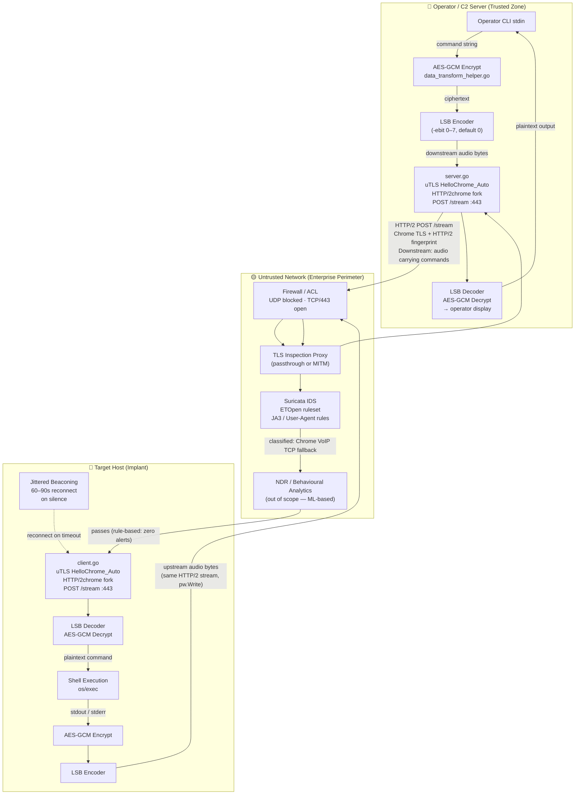

# Threat Model: callnC2

> This document details the architectural threat model for `callnC2` using the **STRIDE** methodology, a **DREAD** risk assessment, and technical alignments with the **MITRE ATT&CK** matrix and **MITRE ATLAS** (where applicable).

---

| Field | Value |
|---|---|
| **Tool** | callnC2 |
| **Version Modelled** | master (current) |
| **Date** | November 2026 |
| **Author** | ajithor |
| **Classification** | Public – Portfolio |
| **Status** | Final |

---

## 1. Introduction

`callnC2` is a proof-of-concept covert command-and-control framework that tunnels encrypted shell commands through LSB-encoded audio bytes over a **single persistent HTTP/2 stream**, impersonating the TCP/443 fallback behaviour of enterprise VoIP clients (Teams, Zoom, Webex). In enterprise environments where UDP is blocked by firewall policy, VoIP applications fall back to a persistent HTTP/2 stream over port 443, which is a well-documented and expected behaviour. `callnC2` exploits this expectation as its cover identity.

This is the direct evolution of `c2ne`, resolving its key limitations:
- **c2ne** used HTTP/1.1 with two separate connections (music stream + scrobble backchannel), creating a detectable asymmetry in scrobble frequency.
- **callnC2** uses a single bidirectional HTTP/2 stream with no polling, no discrete requests after the initial connection, and continuous audio flow in both directions — identical to a real VoIP call.

Additional improvements over c2ne include: a configurable bit plane (`-ebit`), jittered beaconing with auto-reconnect, a custom `http2chrome` fork for byte-accurate HTTP/2 frame fingerprinting, and verification against tls.peet.ws Akamai fingerprint.

---

## 2. Scope and Assumptions

### 2.1 In Scope

- `server.go` — operator-side C2 server (uTLS + HTTP/2chrome, persistent POST /stream listener)
- `client.go` — implant binary (target-side; uTLS + HTTP/2chrome, POST /stream initiator)
- `data_transform_helper.go` — LSB encode/decode and AES-GCM encrypt/decrypt
- AES-GCM symmetric key (hardcoded at compile time — acknowledged limitation)
- TLS keypair (`server.key`, `server.crt`)
- `github.com/ajithor/http2chrome` — custom fork of `golang.org/x/net` with Chrome HTTP/2 frame behaviour
- Bidirectional audio byte stream (single HTTP/2 POST /stream)
- Beaconing and reconnect mechanism
- Target network perimeter (DPI, TLS inspection, NDR, Suricata)

### 2.2 Out of Scope

- Initial access mechanism delivering the implant to the target
- Privilege escalation on the target host
- Host-based detection evasion (AV/EDR, process injection, memory execution)
- Key distribution infrastructure (key hardcoded; acknowledged limitation)
- Cryptographic strength of AES-GCM (assumed correct — Go standard library)
- Enterprise ML-based NDR (Darktrace, Vectra, Cortex XDR) — explicitly out of scope in codebase

### 2.3 Assumptions

- Both client and server compiled with the same hardcoded AES-GCM key.
- Server runs on attacker-controlled infrastructure with a valid self-signed TLS certificate.
- The target environment is an enterprise network with Suricata IDS (ETOpen ruleset), egress filtering to port 443, and potentially TLS inspection.
- The target firewall blocks UDP; VoIP TCP/443 fallback behaviour is therefore expected by defenders.
- The implant initiates all connections outbound; no inbound connection to the target is required.
- Chrome version 124–147 HTTP/2 and TLS fingerprint is the impersonation target (verified against tls.peet.ws).
- Jittered reconnect interval is 60–90 seconds on data or command silence.

---

## 3. Architecture Overview

```
Operator CLI stdin
      │
  AES-GCM encrypt
      │
  LSB encode → downstream audio bytes
      │
  server.go (uTLS + HTTP/2chrome)
      │
  Single persistent HTTP/2 POST /stream (:443)
  TLS: HelloChrome_Auto
  HTTP/2: Chrome 124–147 frame order (http2chrome)
      │
  ┌───┴──────────────────────────────────────┐
  │       Untrusted Network (Enterprise)      │
  │  Firewall · DPI · TLS Proxy · NDR         │
  └───────────────────┬──────────────────────┘
                      │
  client.go (uTLS + HTTP/2chrome)
  resp.Body → LSB decode → AES-GCM decrypt
      │
  Shell execute (os/exec)
      │
  output → AES-GCM encrypt → LSB encode
      │
  pw.Write → upstream audio bytes (same HTTP/2 stream)
      │
  ┌───┴──────────────────────────────────────┐
  │       Untrusted Network (back to server)  │
  └───────────────────┬──────────────────────┘
                      │
  server.go receives upstream bytes
  LSB decode → AES-GCM decrypt → operator display

[Silence timeout: beaconing reconnect after 60–90s jitter]
```

The key architectural distinction from c2ne: **no second connection exists on the wire**. The same HTTP/2 stream carries audio in both directions simultaneously, like a real VoIP call. No polling, no scrobble anomaly, no asymmetry.

---

## 4. System Boundary and Dataflow Diagram (generated by AI)



**Trust boundary** sits at the enterprise perimeter. All traffic appears as a single persistent HTTPS connection with Chrome's exact TLS and HTTP/2 fingerprint, mirroring the VoIP TCP/443 fallback documented by Teams, Zoom, and Webex.

---

## 5. Assets

| Asset | Description | Sensitivity |
|---|---|---|
| AES-GCM symmetric key | 16-byte hardcoded key; compromise = decrypt all sessions | **Critical** |
| TLS private key (`server.key`) | Protects TLS transport; loss allows passive decryption | **Critical** |
| TLS certificate (`server.crt`) | Contains CN=`callnC2.local`; distinctive IOC | **High** |
| Implant binary (`client`) | Contains key, LSB engine, shell executor | **Critical** |
| Server binary | Contains key, decryption logic, operator CLI | **Critical** |
| `http2chrome` fork dependency | Custom `golang.org/x/net` fork; supply chain asset | **High** |
| HTTP/2 + TLS fingerprint profile | Chrome 124–147 wire behaviour; enables evasion | **High** |
| Beaconing interval config | 60–90s jitter parameters; could assist traffic profiling by defenders | **Low** |
| Shell output data | Sensitive data exfiltrated via upstream audio | **High** |
| Operator IP / server address | Destination IP of persistent HTTP/2 stream | **High** |

---

## 6. Trust Boundaries

| Boundary | Description |
|---|---|
| **TB-1** | Operator machine ↔ C2 server: fully trusted; assumed co-located or private VPN |
| **TB-2** | C2 server ↔ Network: attacker-controlled egress; TLS terminates here |
| **TB-3** | Network ↔ Target host: hostile; enterprise DPI, TLS inspection, Suricata, potential NDR |
| **TB-4** | Target OS ↔ Implant process: semi-trusted; EDR may intercept syscalls and I/O |
| **TB-5** | Implant ↔ Shell: trusted (local); output is captured and encrypted before it touches the network |
| **TB-6** | Build environment ↔ `http2chrome` dependency: trusted (go.mod pinned) but supply chain risk exists |

---

## 7. Threat Actors

| Actor | Description | Motivation |
|---|---|---|
| **Target SOC / Blue Team** | Network monitoring, endpoint telemetry, SIEM correlation | Detect and evict the operator |
| **Automated IDS (Suricata/ETOpen)** | Signature-based JA3, user-agent, and C2 rules | Alert on known bad TLS/HTTP patterns |
| **NDR with Behavioural Analytics** | ML-based traffic profiling (Darktrace, Vectra, Cortex XDR) | Detect anomalous persistent stream behaviour |
| **Reverse Engineer** | Static/dynamic analysis of implant binary | Extract key, understand LSB protocol, generate YARA rules |
| **TLS Inspection Proxy (MITM)** | Active interception of TLS traffic (enterprise CA installed on host) | Inspect decrypted plaintext; detect LSB-encoded audio as anomalous audio content |
| **Supply Chain Attacker** | Compromise of `ajithor/http2chrome` fork | Inject backdoor into the HTTP/2 transport layer |

---

## 8. STRIDE Analysis

### 8.1 AES-GCM Key (Hardcoded Symmetric Key)

| ID       | Category                   | Threat Description                                                                                                                                                                                                                            | Current Mitigation | Gap                                                                             |
| -------- | -------------------------- | --------------------------------------------------------------------------------------------------------------------------------------------------------------------------------------------------------------------------------------------- | ------------------ | ------------------------------------------------------------------------------- |
| CNC2-S01 | **Spoofing**               | The hardcoded symmetric key extracted from the implant binary allows an adversary to impersonate the operator, hence crafting forged commands that the implant will execute as valid C2 traffic.                                              | None               | Implement X25519 ephemeral key exchange + HKDF-derived AES key; forward secrecy |
| CNC2-T01 | **Tampering**              | Key knowledge enables forgery of AES-GCM ciphertext. An adversary intercepting the HTTP/2 stream with a TLS MITM proxy (and the key) could inject arbitrary shell commands into the downstream audio.                                         | None               | Asymmetric key exchange; signature on command origin                            |
| CNC2-I01 | **Information Disclosure** | The 16-byte key is extractable via static binary analysis. All previously captured HTTP/2 sessions (if TLS was decrypted by a proxy or via key log file) can then be fully decrypted by stripping LSB from audio and running AES-GCM decrypt. | None               | Ephemeral session keys; key material never stored in binary                     |

### 8.2 TLS Certificate

| ID | Category | Threat Description | Current Mitigation | Gap |
|---|---|---|---|---|
| CNC2-I02 | **Information Disclosure** | CN=`callnC2.local` is a distinctive IOC visible in JA3S logs, Zeek TLS metadata, and any SIEM inspecting certificate subjects. It directly fingerprints this tool and is trivially detectable by a threat hunter reviewing TLS certificate logs. | None | Randomise CN at build time; use a CA-signed cert with a benign-looking domain |
| CNC2-S02 | **Spoofing** | A defender who discovers the server CN and IP could sinkhole the implant by deploying a honeypot TLS server, responding to beaconing implants and collecting the binary or serving counterfeit commands. | None | Use domain fronting; short-lived infrastructure; rotate IPs per engagement |

### 8.3 HTTP/2 Fingerprint (http2chrome Dependency)

| ID | Category | Threat Description | Current Mitigation | Gap |
|---|---|---|---|---|
| CNC2-T02 | **Tampering** | Chrome version updates can change HTTP/2 SETTINGS order, WINDOW_UPDATE values, or pseudo-header ordering. If Chrome 148+ alters the wire behaviour, the hardcoded http2chrome frame profile becomes stale and potentially detectable by JARM or Akamai fingerprint comparison. | Verified against Chrome 124–147 (tls.peet.ws); documented in README | Requires active maintenance; version drift is a future detection risk |
| CNC2-E01 | **Elevation of Privilege** | `http2chrome` is a custom fork of `golang.org/x/net`. If the fork is compromised (e.g., a malicious commit to the `ajithor/http2chrome` repository), the operator's build environment could include a backdoored HTTP/2 transport layer. | `go.mod` pins the dependency (`replace` directive) | Fork integrity should be verified with `go mod verify` and git commit signing |

### 8.4 Single Persistent HTTP/2 Stream

| ID | Category | Threat Description | Current Mitigation | Gap |
|---|---|---|---|---|
| CNC2-T03 | **Tampering** | LSB encoding is fragile to any network device that modifies audio byte values. A WAN optimiser, transcoding proxy, or traffic shaper that alters bytes will corrupt the covert channel. The configurable bit plane (`-ebit`) partially mitigates this but introduces audio distortion at higher planes. | `-ebit` flag allows bit planes 0–7; higher planes survive more aggressive modification | Bits 6–7 introduce audible distortion; bit-exact delivery required for bit 0 |
| CNC2-D01 | **Denial of Service** | A single persistent `POST /stream` is a single point of failure. If the connection is interrupted (IP blocked, session killed, network disruption), all C2 is lost until the implant reconnects. | Jittered beaconing (60–90s) handles reconnect | 60–90s C2 coverage gap; no fallback transport during the gap |
| CNC2-I03 | **Information Disclosure** | A single very-long-lived HTTP/2 POST to a consistent destination IP, carrying a constant bidirectional audio byte flow, is unusual for real VoIP clients (which typically establish new sessions per call). At the TCP session level, session duration is a detectable signal for a network forensics analyst. | Traffic *pattern* (continuous audio) mimics real VoIP | Session *duration* far exceeds typical VoIP call length |

### 8.5 Beaconing Mechanism

| ID | Category | Threat Description | Current Mitigation | Gap |
|---|---|---|---|---|
| CNC2-I04 | **Information Disclosure** | The jittered reconnect interval (60–90s) has a bounded distribution. An NDR product sampling inter-connection times over multiple beacons can profile the interval distribution and identify the jitter range as atypical for real VoIP fallback, which reconnects faster. | Jitter reduces determinism vs a fixed interval | The bounded 60–90s range is a machine-learnable signature; `exponential` or `Pareto` jitter would be harder to profile |
| CNC2-R01 | **Repudiation** | No C2-layer audit trail of commands. If the implant executes a destructive command, there is no server-side record of what was sent. | None | Implement optional encrypted server-side command journal |

### 8.6 Implant Binary

| ID | Category | Threat Description | Current Mitigation | Gap |
|---|---|---|---|---|
| CNC2-D02 | **Denial of Service** | The Go binary (static ELF/PE) is detectable by host-based AV via file hash, import analysis, or string scanning once a sample is submitted. Detection kills the C2 session. | Acknowledged in README (garble, direct syscalls, process injection noted as future work) | Out of scope for this project |
| CNC2-R02 | **Repudiation** | The implant executes shell commands (`os/exec`). Commands executed on behalf of the operator leave traces in shell history, process trees, and system logs that do not reference the C2 channel — making command attribution to `callnC2` difficult but not impossible for a forensics analyst. | No C2-layer suppression of host-side artefacts | Beyond scope; host forensics evasion not in scope |
| CNC2-E02 | **Elevation of Privilege** | The implant executes at the privilege level of the initial access account. No privilege escalation is built in. | Out of scope by design | — |

### 8.7 Nonce Handling

| ID | Category | Threat Description | Current Mitigation | Gap |
|---|---|---|---|---|
| CNC2-I05 | **Information Disclosure** | Per the codebase: nonce is prepended to ciphertext `(nonce ‖ ciphertext ‖ tag)`. The nonce is public by AES-GCM design and leaks no plaintext, but it confirms to a passive observer that AES-GCM is in use and reveals message boundaries within the LSB-decoded stream. | Per-message random nonce via `crypto/rand`; correct per NIST SP 800-38D | No gap — this is correct cryptographic practice. Observable by an analyst who has decoded the LSB layer. |

---

## 9. DREAD Risk Assessment

DREAD scoring: **D**amage · **R**eproducibility · **E**xploitability · **A**ffected scope · **Di**scoverability (all 1–5)  
Rating: **Low** ≤ 2.0 · **Medium** 2.1–3.0 · **High** 3.1–4.0 · **Critical** ≥ 4.1

| Threat ID | Description | D | R | E | A | Di | Score | Rating |
|---|---|---|---|---|---|---|---|---|
| CNC2-I01 | AES-GCM key extracted → full session decryption | 5 | 5 | 4 | 5 | 4 | **4.6** | **Critical** |
| CNC2-S01 | Key extracted → forge operator commands to implant | 5 | 4 | 4 | 5 | 3 | **4.2** | **Critical** |
| CNC2-T01 | Key + TLS MITM → inject arbitrary shell commands | 5 | 3 | 4 | 5 | 3 | **4.0** | **High** |
| CNC2-I02 | TLS cert CN `callnC2.local` as IOC | 4 | 5 | 5 | 4 | 5 | **4.6** | **Critical** |
| CNC2-D02 | Static Go binary quarantined by host AV | 4 | 4 | 3 | 4 | 4 | **3.8** | **High** |
| CNC2-I03 | Unusual session duration detectable at TCP level | 3 | 4 | 2 | 3 | 4 | **3.2** | **High** |
| CNC2-I04 | 60–90s beacon interval profiled by NDR | 3 | 3 | 2 | 3 | 4 | **3.0** | **Medium** |
| CNC2-T02 | Chrome fingerprint drift on v148+ update | 3 | 3 | 2 | 3 | 3 | **2.8** | **Medium** |
| CNC2-D01 | Single-stream disruption = 60–90s C2 gap | 3 | 4 | 2 | 3 | 2 | **2.8** | **Medium** |
| CNC2-S02 | Defender honeypot collects binary / infra data | 4 | 2 | 3 | 4 | 2 | **3.0** | **Medium** |
| CNC2-T03 | WAN optimiser corrupts LSB layer | 3 | 2 | 2 | 3 | 2 | **2.4** | **Medium** |
| CNC2-E01 | `http2chrome` fork compromised (supply chain) | 5 | 1 | 2 | 5 | 1 | **2.8** | **Medium** |
| CNC2-R01 | No server-side command log | 2 | 5 | 5 | 2 | 2 | **3.2** | **High** |
| CNC2-I05 | Nonce leaks message boundaries (correctly handled) | 1 | 5 | 1 | 1 | 3 | **2.2** | **Medium** |
| CNC2-E02 | Shell at initial access privilege (by design) | 2 | 2 | 1 | 2 | 2 | **1.8** | **Low** |

---

## 10. MITRE ATT&CK Matrix Alignment

| Tactic | Technique ID | Technique Name | Implementation in `callnC2` |
|---|---|---|---|
| Command and Control | **T1071.001** | Application Layer Protocol: Web Protocols | All C2 traffic uses HTTP/2 on port 443 with handcrafted Chrome request/response headers |
| Command and Control | **T1573.001** | Encrypted Channel: Symmetric Cryptography | AES-GCM (AES-128) encryption of all commands and shell output; nonce prepended per message |
| Command and Control | **T1001** | Data Obfuscation | Commands and output are hidden within audio byte streams via configurable LSB steganography |
| Command and Control | **T1001.003** | Protocol Impersonation | uTLS `HelloChrome_Auto` + http2chrome fork impersonates Chrome browser on enterprise VoIP TCP/443 fallback; Akamai fingerprint verified |
| Command and Control | **T1008** | Fallback Channels | Jittered beaconing (60–90s) automatically re-establishes the C2 stream on data or command silence |
| Command and Control | **T1095** | Non-Application Layer Protocol | Custom manipulation of HTTP/2 frame order (SETTINGS, WINDOW_UPDATE, PRIORITY, pseudo-headers) to match Chrome's exact wire behaviour via http2chrome fork |
| Defense Evasion | **T1027** | Obfuscated Files or Information | LSB steganography hides the C2 payload within audio sample data; payload is indistinguishable from audio noise at bit-0 |
| Defense Evasion | **T1036** | Masquerading | Chrome TLS fingerprint (`HelloChrome_Auto`), Chrome HTTP/2 frame profile (`http2chrome`), and VoIP call headers masquerade as a legitimate Chrome client on a VoIP call |
| Defense Evasion | **T1036.005** | Match Legitimate Name or Location | Server endpoint `POST /stream` and Chrome header set match the TCP/443 fallback documented by Teams, Zoom, and Webex |
| Defense Evasion | **T1070** | Indicator Removal | Request jitter mimics natural VoIP audio buffer refill; prevents fixed-interval beacon detection |
| Defense Evasion | **T1497** | Virtualization/Sandbox Evasion | (Partial) The VoIP impersonation makes automated sandbox analysis less likely to flag the traffic as C2 |
| Execution | **T1059.004** | Command and Scripting Interpreter: Unix Shell | Shell output returned via `os/exec`; implant executes operator-issued commands in a system shell |
| Execution | **T1059.003** | Command and Scripting Interpreter: Windows Command Shell | Implant cross-compiles for Windows; shell execution is functional |
| Exfiltration | **T1041** | Exfiltration Over C2 Channel | Shell output returned as upstream audio bytes within the same HTTP/2 stream |
| Discovery | **T1057** | Process Discovery | Available via shell commands once C2 is established |
| Resource Development | **T1587.001** | Develop Capabilities: Malware | Purpose-built offensive framework; compiled per engagement |
| Resource Development | **T1588.001** | Obtain Capabilities: Malware | `http2chrome` fork is a purpose-built C2 transport component |
| Credential Access | **T1552** | Unsecured Credentials | Hardcoded AES-GCM key in binary is an unsecured credential; binary capture exposes it |
| Impact | **T1489** | Service Stop | (Via shell) Once C2 is established, operator can issue arbitrary shell commands including service disruption |

---

## 11. MITRE ATLAS

MITRE ATLAS covers adversarial techniques that target AI/ML systems and their training pipelines. `callnC2` does not target AI/ML systems. Its primary evasion layer is validated against **rule-based IDS** (Suricata with Emerging Threats Open ruleset, August 2026): zero alerts were observed across a full command/response session.

However, `callnC2` has a meaningful and direct alignment with ATLAS that `c2ne` does not: the tool explicitly and systematically **impersonates a known application profile at the network traffic classification layer**. The Akamai HTTP/2 fingerprint (`1:65536;2:0;4:6291456;6:262144|15663105|0|m,a,s,p`), verified against Chrome 124–147, is the exact adversarial data input used to fool traffic classifiers, including ML-based ones trained on application fingerprints.

| ATLAS Technique ID | Technique Name | Relevance to `callnC2` |
|---|---|---|
| **AML.T0043** | Craft Adversarial Data | The fabricated Chrome HTTP/2 frame profile, TLS ClientHello, and VoIP session structure are adversarially crafted inputs designed to fool network traffic classification systems. The peet.ws verification step confirms the crafted fingerprint is indistinguishable from real Chrome to an automated classifier. |
| **AML.T0015** | Evade ML Model | The jittered audio byte flow, Chrome VoIP call behaviour (continuous bidirectional stream), and exact Akamai fingerprint matching are designed to evade ML-based network traffic classifiers that profile application behaviour. The README explicitly acknowledges ML-based NDR (Darktrace, Vectra, Palo Alto Cortex XDR) as an unsolved evasion problem, confirming the tool's awareness of this threat model. |
| **AML.T0000** | Reconnaissance of ML Models | Implicit: identifying that enterprise NDR products use fingerprint-based and behavioural ML models (and explicitly scoping them as out of range) is a form of adversary ML recon — understanding the detection model in order to evade it. |

**Assessment**: ATLAS alignment is **direct and intentional** for AML.T0043 and AML.T0015. The tool is designed to produce a specific network-layer fingerprint that matches a training data class (Chrome browser), constituting adversarial data crafting against traffic classification systems. This is one of the more sophisticated examples of ATLAS-aligned evasion in a network-layer offensive tool.

---

## 12. Security Controls and Mitigations

| Threat ID | Recommended Control | Priority |
|---|---|---|
| CNC2-I01 / CNC2-S01 / CNC2-T01 | Replace hardcoded symmetric key with X25519 ephemeral key exchange + HKDF-derived AES key; destroy key material from binary at build time; provides forward secrecy | **Critical** |
| CNC2-I02 | Randomise TLS cert CN at build time (`ldflags`); obtain a CA-signed cert for a benign-looking domain; consider domain fronting | **Critical** |
| CNC2-D02 | Compile with `garble`; strip debug symbols (`-s -w`); use in-memory execution (reflective load); direct syscalls to bypass import table analysis | **High** |
| CNC2-I03 | Implement per-session connection cycling to simulate a call ending and a new call starting; bound maximum session duration to realistic VoIP call lengths (~60 minutes) | **High** |
| CNC2-R01 | Implement optional encrypted server-side command journal (append-only, AES-GCM encrypted log) | **High** |
| CNC2-I04 | Replace bounded uniform jitter (60–90s) with an exponential or Pareto distribution; this is harder to profile statistically and closer to realistic VoIP reconnect timing | **Medium** |
| CNC2-T02 | Track Chrome HTTP/2 changelog; automate Akamai fingerprint regression tests via `tls.peet.ws` CI check on each Chrome release | **Medium** |
| CNC2-E01 | Enable `go mod verify` in CI pipeline; sign `http2chrome` commits; consider vendoring the dependency | **Medium** |
| CNC2-T03 | Test against target proxy class before deployment; use `-ebit 1` or higher in environments with active WAN optimisers; document that bit-0 requires byte-exact delivery | **Medium** |
| CNC2-S02 | Use short-lived, single-use infrastructure; deploy behind a CDN or domain-fronted distribution point; rotate per engagement | **Medium** |

---

## 13. Residual Risk Summary

| Residual Risk | Rationale |
|---|---|
| **Hardcoded symmetric key** | The highest single risk. Until X25519 key exchange is implemented, any binary capture gives an adversary full decryption of all sessions. This is an acknowledged design limitation in the codebase. |
| **Session duration anomaly** | Even with per-session cycling, a VoIP call that lasts for the duration of an engagement (days/weeks) is atypical. A network forensics analyst reviewing long-lived TCP sessions to a single external IP will flag this regardless of fingerprint quality. |
| **Host-based detection** | Explicitly out of scope. The Go binary is detectable by any modern EDR product that samples file hashes or observes import behaviour. This is the highest practical detection risk in a real engagement. |
| **Chrome fingerprint maintenance** | The Akamai fingerprint requires active maintenance against Chrome releases. A defender using JARM or Akamai fingerprinting who updates their Chrome baseline more frequently than the tool is updated will detect the drift. |
| **ML-based NDR (Darktrace, Vectra)** | Explicitly scoped out of testing. Products with behavioural baselines, peer group analysis, and long-term traffic modelling will likely detect the persistent stream pattern and jitter distribution over time, even if each individual packet looks legitimate. |
| **Operator IP** | The C2 server address is embedded in the implant binary and is the destination of the persistent stream. Threat intelligence enrichment of that IP post-engagement can retrospectively attribute sessions from the network logs. |

---

*This document should be reviewed and updated when the LSB engine, encryption module, beaconing logic, or HTTP/2 fingerprint profile is modified, and whenever Chrome releases a version that changes the target HTTP/2 wire behaviour.*
